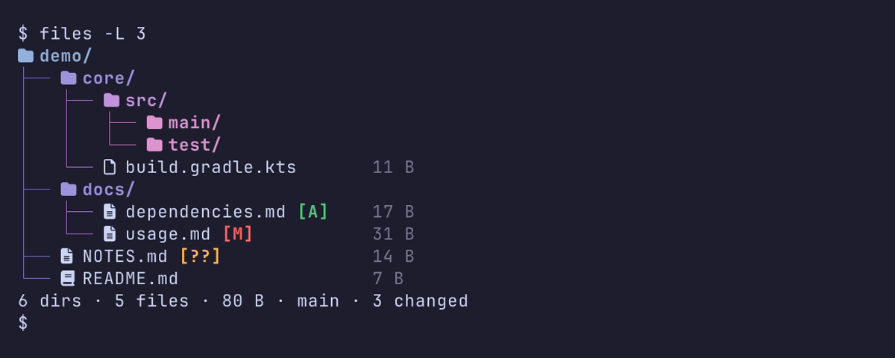
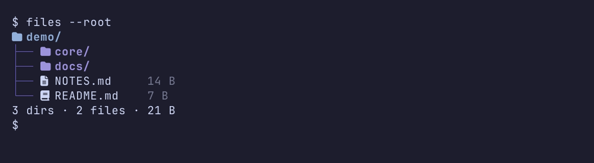
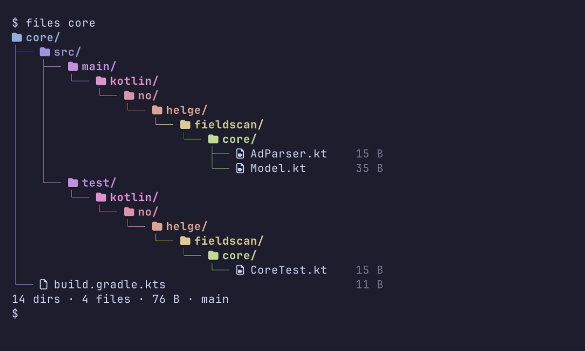
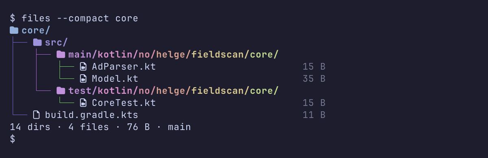
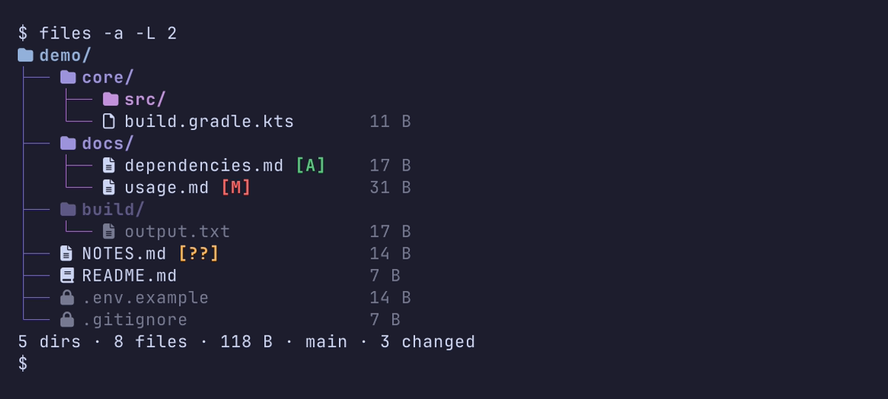
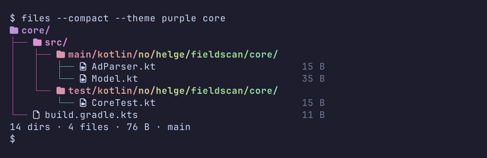
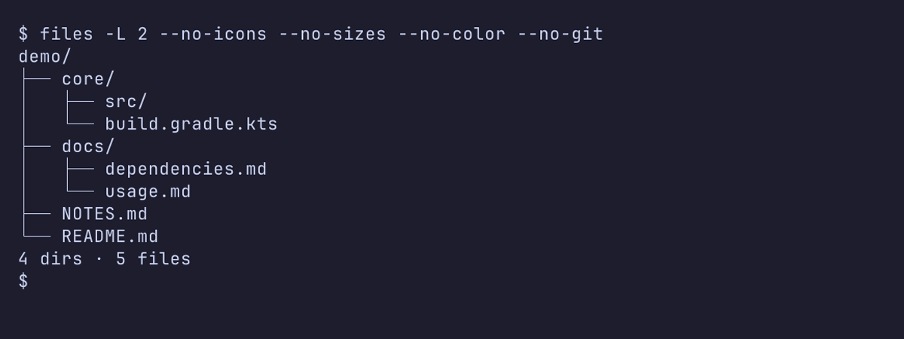

# Files

A directory tree for your terminal, with file sizes, folder colors, and Git
status. Files respects `.gitignore` and skips common build and dependency
folders by default. It works on macOS, Linux, and Windows.

```sh
files                  # current directory
files ~/code/project   # another directory
files --compact        # fold long folder chains onto one row
```



## Install

With Homebrew on macOS or Linux:

```sh
brew install helgesverre/tap/files
```

Or download the latest binary with the installer. This also works in Git Bash
on Windows; you do not need Nim installed.

```sh
curl -fsSL https://raw.githubusercontent.com/HelgeSverre/files/main/install.sh | bash
```

The folder and file icons need a [Nerd Font](https://www.nerdfonts.com/).
If your terminal shows boxes instead of icons, use `--no-icons`.
Git is optional; without it, Files shows the tree without status badges.

## Choose how much to show

### Limit the depth

Use `-L` (or `--depth`) to stop after a given number of levels below the
requested directory. `files -L 2` shows its children and their children.

For a quick look at the top level, `--root` is shorthand for
`--depth=1 --no-git`:

```sh
files --root
```



### Fold long folder paths

`--compact` puts consecutive folders on one row when each contains exactly
one visible child and that child is another folder. This is useful for Java
and Kotlin package trees.

Without compaction:

```sh
files core
```



With compaction:

```sh
files --compact core
```



Every folder name keeps its depth color. Branches, files, and symlinks stop a
chain. The requested root stays on its own row, and hidden or ignored folders
stay separate from visible ones. Filtering happens before compaction.

`--depth` still counts actual folders, and the footer still counts all
collected directories, including those folded onto one row.

Compaction is off by default. To make it your default, add this to your shell
configuration:

```sh
export FILES_COMPACT=1
```

Use `--no-compact` to expand folders for one command. Explicit flags override
the environment; if both flags appear, the last one wins. `FILES_COMPACT`
also accepts `0`, `true/false`, `yes/no`, and `on/off`, without regard to case.

### Show hidden and ignored entries

Files normally hides dotfiles, entries matched by `.gitignore`, and common
generated folders such as `node_modules`, `build`, and `target`. Use `-a`
(or `--all`) to show them in dim text:

```sh
files -a -L 2
```



To include built-in ignored folders while still respecting `.gitignore`, use
`--no-defaults`. A folder explicitly ignored by `.gitignore` remains hidden
unless you also use `-a`.

Add your own exclusions with `-I` or `--ignore`. Quote globs so your shell
does not expand them, and repeat the flag for multiple patterns:

```sh
files -I '*.lock' -I 'coverage/'
```

## Change the appearance

### Colors

Folder and connector colors change with depth. The default theme is
`rainbow`; `--theme` changes the starting color. Choices are `blue`, `purple`,
`green`, `red`, `orange`, `yellow`, and `rainbow`.

```sh
files --compact --theme purple core
```



Set a default with `export FILES_COLOR_THEME=purple`. An explicit `--theme`
takes precedence.

Colors are enabled automatically in a terminal and omitted when output is
piped. Use `--color=always` to keep colors in a pipe, or `--color=never`
(or `--no-color`) to turn them off. Files also honors `NO_COLOR`;
`--color=always` overrides it.

### Icons and sizes

Use `--no-icons` for a terminal without a Nerd Font, and `--no-sizes` for a
narrower tree. File sizes are enabled by default; `-t` or `--sizes` turns them
back on.

```sh
files -L 2 --no-icons --no-sizes --no-color --no-git
```



## Read Git status

Files adds badges beside changed files and shows the branch in the footer.
The overview screenshot shows a staged addition (`[A]`), an unstaged edit
(`[M]`), and an untracked file (`[??]`). Staged changes are green; unstaged
changes are red. Conflicts use `[!]`.

Use `--no-git` to skip Git lookups. Symlinks are shown with their targets and
are never traversed.

## All flags

```text
files [options] [path]
```

The path defaults to the current directory.

| Flag | Effect | Environment variable |
| --- | --- | --- |
| `-a`, `--all` | Show hidden and ignored entries in dim text | — |
| `-L`, `--depth <n>` | Stop after `n` directory levels | — |
| `--root` | Show one level and skip Git (`--depth=1 --no-git`) | — |
| `-I`, `--ignore <glob>` | Exclude another pattern; repeat as needed | — |
| `--compact` | Fold single-child folder chains onto one row | `FILES_COMPACT=1` |
| `--no-compact` | Show each folder on its own row (default) | `FILES_COMPACT=0` |
| `-t`, `--sizes` | Show file sizes (default) | — |
| `--no-sizes` | Hide file sizes | — |
| `--no-icons` | Hide Nerd Font icons | — |
| `--color <when>` | `auto` (default), `always`, or `never` | `NO_COLOR` disables colors when nonempty; no environment setting for `auto` or `always` |
| `--no-color` | Same as `--color=never` | `NO_COLOR=1` (any nonempty value) |
| `--theme <name>` | Choose the starting color for the depth gradient | `FILES_COLOR_THEME=<name>` |
| `--no-git` | Skip Git status and branch lookups | — |
| `--no-defaults` | Disable built-in ignore patterns; keep `.gitignore` rules | — |
| `--completions <shell>`, `--completion <shell>` | Generate Zsh, Bash, Fish, or Nushell completions | — |
| `-h`, `--help` | Show help | — |
| `-v`, `--version` | Show the installed version | — |
Explicit flags override environment settings. For example, `--no-compact`
overrides `FILES_COMPACT=1`, and `--color=always` overrides `NO_COLOR`.
A dash means the flag has no environment equivalent.

## Shell completions

Generate completions with `files --completions <shell>`.

For Zsh, save the script as `_files_cli` in a directory on your `fpath`.
**Do not name it `_files`**: that would override Zsh's own file completion
function. If you use `~/.zsh/completions`:

```sh
mkdir -p ~/.zsh/completions
files --completions zsh > ~/.zsh/completions/_files_cli
```

Add that directory to `fpath` before your existing `compinit` call. If your
shell has no completion setup yet, add these lines to `~/.zshrc`:

```sh
fpath=(~/.zsh/completions $fpath)
autoload -Uz compinit
compinit
```

In an already-open shell, reload the completion file after replacing it:

```sh
source ~/.zsh/completions/_files_cli
```

For Bash, load it in your shell configuration:

```sh
eval "$(files --completions bash)"
```

For Fish:

```sh
mkdir -p ~/.config/fish/completions
files --completions fish > ~/.config/fish/completions/files.fish
```

For Nushell, save and load the generated module:

```nu
files --completions nu | save --force files-completions.nu
use ./files-completions.nu *
```

Regenerate saved completion files after upgrading to pick up new flags.

## Build from source

Requires [Nim 2.0+](https://nim-lang.org/install.html) and
[just](https://github.com/casey/just).

```sh
git clone https://github.com/HelgeSverre/files.git
cd files
just install
```

This builds Files and installs it to `~/.local/bin`; make sure that directory
is on your `PATH`. To build without installing, run `just build` and use
`./bin/files`.

```sh
just test        # all unit and integration tests
just build       # optimized binary at bin/files
just run         # build and show this repository
just bump patch  # bump the version, tag, and push a release from main
```

The code uses Nim's standard library. `files/walk.nim` collects and filters
the tree, `files/render.nim` draws it, and `files/options.nim` defines the CLI.
On macOS, directory enumeration uses `getattrlistbulk`; other platforms use
Nim's directory walker.

Release CI tests and builds macOS and Linux binaries for arm64 and x86_64,
plus Windows x86_64 binaries. See [the build workflow](.github/workflows/build.yml).

To recreate the README screenshots, install [VHS](https://github.com/charmbracelet/vhs)
and JetBrainsMono Nerd Font, build Files, and run `bash scripts/screenshots.sh`.
The script creates a temporary example repository and captures real terminal
output.
